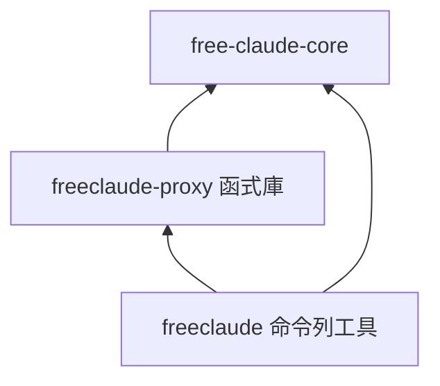
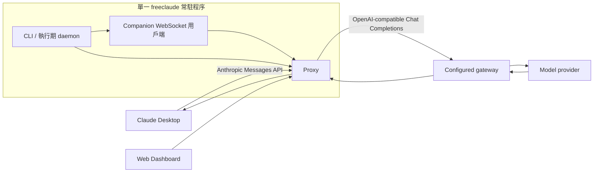
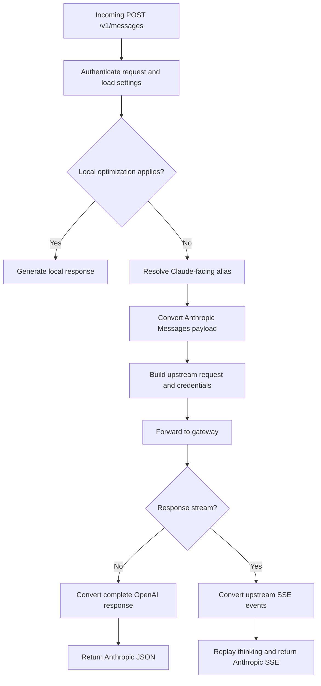
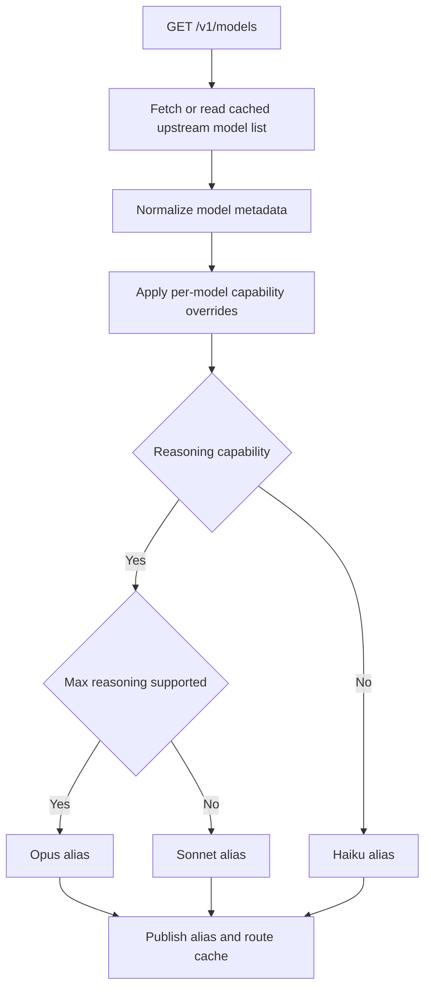
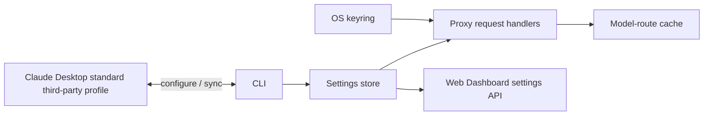

# Architecture

This document describes the internal structure and execution paths of FreeClaudeDesktop. For installation, operation, supported platforms, and security guidance, see [../README.md](../README.md).

## Crate boundaries

| Crate | Internal responsibility |
| --- | --- |
| `free-claude-core` (`core/`) | Shared schemas, persistent settings, model discovery and routing, request/response conversion, and launcher integration. |
| `freeclaude-proxy` (`proxy/`) | Axum 路由、驗證、Gateway 轉送、SSE 轉換、Web Dashboard 與伺服器生命週期管理的函式庫。 |
| `freeclaude` (`cli/`) | 單一原生執行檔，負責命令協調，並在同一個常駐程序中執行 Proxy server 與 companion WebSocket。 |

依賴方向由外向內：CLI 依賴 Proxy 函式庫與 `free-claude-core`；Proxy 函式庫依賴 `free-claude-core`。

## Runtime topology

Proxy 負責協定轉換：接收 Claude 相容請求，再由 Gateway adapter 將 OpenAI 相容請求送往上游。Companion 連線讓 Web Dashboard 能與宿主端常駐程序協作，同時將宿主控制邏輯留在 Proxy 函式庫之外。

> **Migration note (v1.x):** Docker runtime has been removed. The project now ships only the native runtime; `FREECLAUDE_COMPOSE_FILE` / `FREECLAUDE_DOCKER_MEMORY_LIMIT` and `Dockerfile`/`compose.yaml` are no longer supported. If port 3000 remains occupied after upgrading, run `docker compose down` manually to clean up orphan containers.

## Message execution flow

## Model discovery and routing

An alias is stable for the returned model-list position and uses a bracketed index, such as `claude-opus-5[0]`. A 1M-context capability is represented by `supports1m: true`; the model ID and display label remain clean. `prefer1m: true` hides the standard variant and offers only the 1M option; false or an unset preference keeps both options. It has no effect without `supports1m`. Alias selection is determined by reasoning support: `max` maps to Opus, other supported reasoning levels map to Sonnet, and models without reasoning support map to Haiku.

During request conversion, explicit `output_config.effort` takes precedence over the legacy `thinking.budget_tokens` mapping. Disabled thinking sends `none` only when the upstream advertises support; adaptive thinking without an explicit effort keeps the upstream default. Base and `[1m]` aliases share capability lookup. In response conversion, upstream reasoning is represented either as native Claude thinking blocks or as inline `<antThinking>` text, according to `reasoning_replay_mode`.

Tool-result images are carried in a user multimodal message after all matching tool responses, with the originating tool ID attached. This preserves screenshots while keeping Chat Completions tool messages textual. Incomplete or unsupported image formats fail explicitly.

## State ownership

- The settings store owns non-secret proxy configuration and model capability overrides.
- The operating-system keyring owns gateway credentials; settings APIs do not return them.
- The CLI owns lifecycle and profile synchronization. The proxy owns request-time model cache state.

## 第三方 Profile 位置

設定庫、MCP、同步與重建操作統一使用 Desktop 的標準第三方目錄：

| 平台 | 目錄 |
| --- | --- |
| Windows | `%LOCALAPPDATA%/Claude-3p` |
| macOS | `$HOME/Library/Application Support/Claude-3p` |
| Linux | `${XDG_CONFIG_HOME:-$HOME/.config}/Claude-3p` |

啟動時不傳入 `--user-data-dir`，也不依賴正式版會移除的 `CLAUDE_USER_DATA_DIR`。首次初始化可複製官方 Profile 的一般資料；同步與重建保留目前 Proxy 設定庫。沒有舊版 `FreeClaudeDesktop/claude_profile` 的遷移邏輯。Windows 官方資料偵測也涵蓋新版 Store 的 `Claude-Data` 與套件資料目錄。
